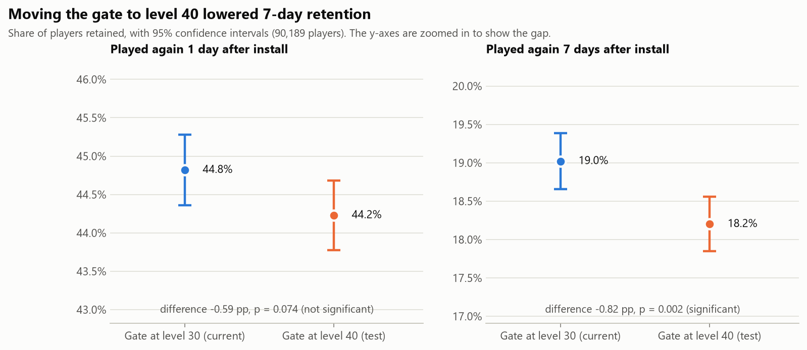
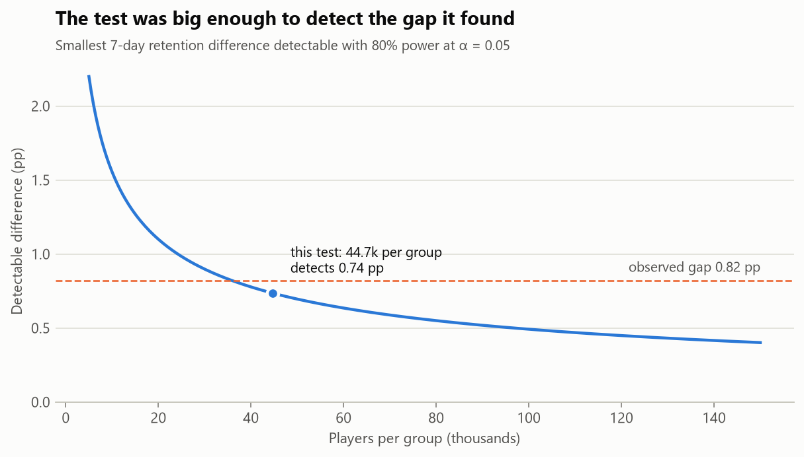
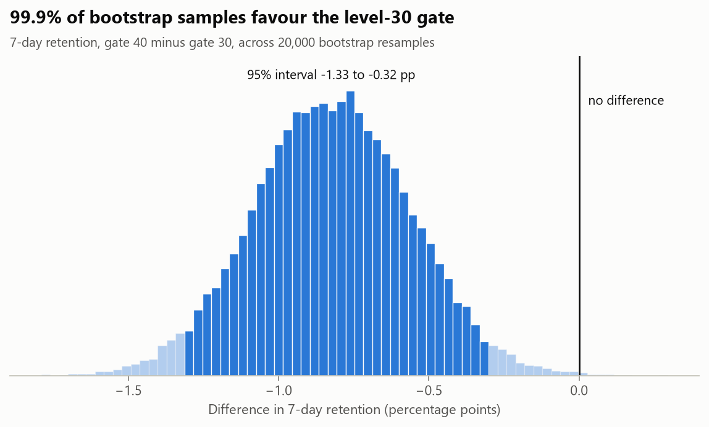
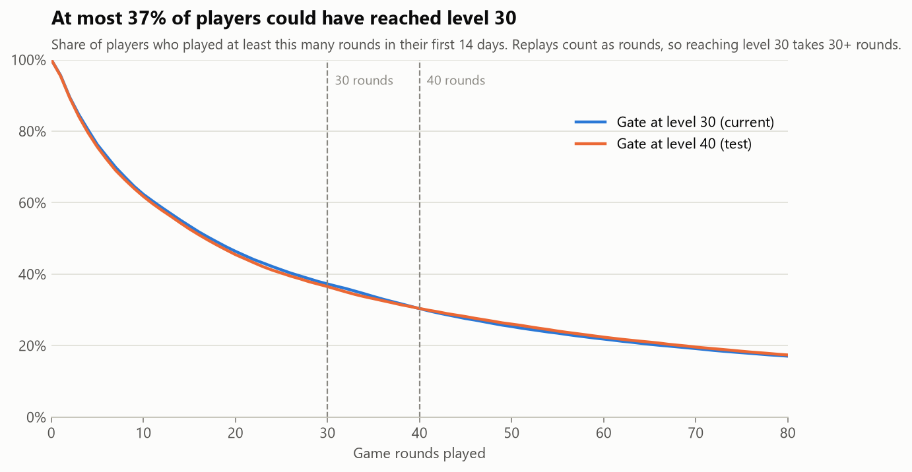

# Cookie Cats A/B Test: Should the First Gate Move to Level 40?

Analysis of a randomized experiment on **90,189 players** of the mobile puzzle game *Cookie Cats*. In the game, players hit a "gate" that makes them wait or pay before they can keep playing. The team tested moving the first gate from **level 30** (the live version) to **level 40**.

## Recommendation: keep the gate at level 30

| Metric | Gate at 30 | Gate at 40 | Difference (95% CI) | p-value |
|---|---|---|---|---|
| **7-day retention** (primary) | 19.02% | 18.20% | **−0.82 pp** (−1.33 to −0.31) | **0.002** |
| 1-day retention (secondary) | 44.82% | 44.23% | −0.59 pp (−1.24 to +0.06) | 0.074 |
| Rounds played, median | 17 | 16 | mean diff −0.04 rounds (−1.40 to +1.29) | 0.050 (Mann-Whitney) |

- Moving the gate to level 40 **lowered 7-day retention by 0.82 points, a 4.3% relative drop** (95% CI −6.9% to −1.7%). The result survives a Holm correction for testing two retention metrics (adjusted p = 0.003).
- In a Bayesian view (flat priors), the chance that gate 40 is better on 7-day retention is **0.08%**. Picking it has an expected cost of 0.82 points of retention, while keeping gate 30 risks almost nothing.
- 1-day retention points the same way but isn't significant. Engagement in rounds played is unchanged in practice.
- At scale this matters: for every 100,000 installs, the level-40 version would have about **820 fewer players still playing after a week**.



## Can the result be trusted? The checks

### 1. Sample ratio mismatch: a warning to investigate

The traffic should split 50/50, but gate 40 got **45,489 players against 44,700** (50.4% vs. 49.6%). A chi-square test says a gap this large would happen by chance less than 1% of the time (**p = 0.009**). This is a *sample ratio mismatch* (SRM), and it usually means something went wrong in assignment or logging. Some players may have been dropped from one group.

What I checked:

- **Is it concentrated?** Split by user-ID decile, only 1 of 10 slices shows a significant imbalance. A homogeneity test finds no difference between slices (p = 0.61), so the skew is small and spread evenly rather than one broken batch ([`srm_by_userid_decile.csv`](reports/srm_by_userid_decile.csv)).
- **Worst case.** Assume gate 30 lost 789 players from the logs, and every one of them churned, the assumption least favourable to gate 30. Gate 40 still trails, by **−0.49 pp** (−0.99 to +0.01, p = 0.057). The direction holds, but under this extreme case the result is no longer clearly significant.

**So:** the recommendation stands, because a change that is very likely harmful and at best neutral isn't worth shipping. Before the next experiment, though, the assignment and logging pipeline should be checked to find where the missing players went.

### 2. Was the test big enough?

With about 44,700 players per group, the test could detect a **0.74-point** change in 7-day retention with 80% power at α = 0.05. The observed gap of 0.82 points is just above that line. For 1-day retention the detectable change was 0.93 points, so the observed −0.59 points could be real and the test was too small to tell. Confirming it would take about **111,000 players per group**.



### 3. A second method agrees

A bootstrap with 20,000 resamples gives a 95% interval of −1.33 to −0.32 pp for 7-day retention, almost identical to the z-test interval, and **99.9% of resamples favour gate 30**.



### 4. Outliers

One gate-30 player logged **49,854 rounds in 14 days** (about 3,500 a day), almost certainly a bot or a logging error. The next highest player logged 2,961. This single row raises the standard deviation of rounds played for gate 30 from 102 to 257, so the mean comparison excludes it. The rank-based Mann-Whitney test and the retention metrics don't need this treatment.

## Why the effect is small: most players never see a gate



Half the players play 16 rounds or fewer in their first two weeks. Replays of failed levels count as rounds, so reaching level 30 takes at least 30 rounds, which means **at most 37% of players could have reached level 30**, and fewer still level 40. Players who stop earlier get the same game in both versions. The −0.82-point drop across all players therefore means a **larger drop among the players the gate actually affects**. That drop can't be measured directly here, because the data doesn't record who reached the gate.

A likely explanation, worth testing: the earlier gate forces a break at a point where players are still engaged. The forced pause makes them come back more often later.

## Method

1. **Metric decided up front.** 7-day retention is the primary metric because it measures long-term value. 1-day retention is secondary, and rounds played is a guardrail.
2. **Validity checks:** duplicate IDs, missing values, sample ratio mismatch, outliers.
3. **Two-proportion z-test** for the difference (pooled standard error for the test, unpooled for the interval), with a delta-method interval for the relative lift.
4. **Holm-Bonferroni** correction across the two retention metrics.
5. **Robustness:** bootstrap, Beta-Binomial posterior, and the SRM worst case.
6. **Power analysis:** minimum detectable effect and the sample size needed for the 1-day effect.

All statistics are written by hand with NumPy and SciPy in [`src/stats_tools.py`](src/stats_tools.py), so each formula is visible. **13 unit tests** check them against SciPy and against simulation in [`tests/test_stats_tools.py`](tests/test_stats_tools.py). For example, they check that the confidence interval covers the true value about 95% of the time, that the false-positive rate is about 5%, and that the power formula matches a simulation.

## Limitations

- **SRM unresolved.** The data comes without assignment logs, so the cause of the imbalance can't be found here. See check 1.
- **No player attributes** (country, device, acquisition channel), so effects can't be checked by segment. Splitting by rounds played would be misleading, because rounds are themselves affected by the gate.
- **Retention is defined as "played on day 1 / day 7"**, not continuous play. About 4% of players returned on day 7 without playing on day 1.
- **No revenue data.** A later gate may change in-app purchases, which matters for a real decision.

## How to run

Requires Python 3.11+.

```bash
pip install -r requirements.txt
```

1. Download [`cookie_cats.csv`](https://www.kaggle.com/datasets/yufengsui/mobile-games-ab-testing) from Kaggle and put it in `data/`.
2. Run from the project root:

```bash
python src/analysis.py                 # every number in this README -> reports/
python src/charts.py                   # reports/figures/*.png
python -m unittest discover tests      # 13 tests (pytest works too)
```

## Project structure

```
├── src/
│   ├── stats_tools.py    # z-test, CIs, Holm, bootstrap, Bayesian, power, SRM
│   ├── analysis.py       # runs every check and test, writes reports/
│   └── charts.py         # README charts
├── tests/
│   └── test_stats_tools.py
├── reports/              # results.json, summary CSVs, figures
└── data/                 # raw CSV (not committed)
```

## Data

[Mobile Games: A/B Testing](https://www.kaggle.com/datasets/yufengsui/mobile-games-ab-testing) on Kaggle, originally from a DataCamp project. Columns: `userid`, `version` (gate_30 / gate_40), `sum_gamerounds` (rounds played in the first 14 days), `retention_1`, `retention_7`. The raw file isn't redistributed here.

## Tools

Python · pandas · NumPy · SciPy · Matplotlib · unittest
